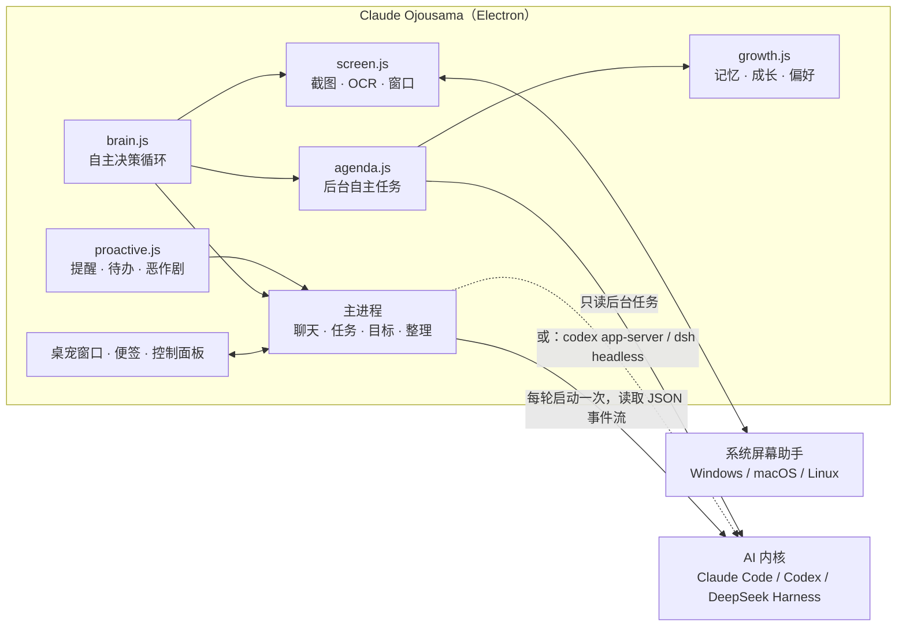

<h1 align="center">🌻 Claude Ojousama</h1>

<p align="center">
  <b>住在你桌面上的像素风 AI 伙伴</b><br/>
  会看你的屏幕、主动帮忙、记得你的习惯——由 Claude Code / Codex / DeepSeek 驱动
</p>

<p align="center">
  
</p>

<p align="center">
  
  
  
  
</p>

**Claude Ojousama**（中文昵称「Claude 大小姐」，小名「小克」）是一个橙发、戴向日葵发饰的像素风程序员少女，带着自己的小 CRT 电脑住在你的任务栏上。她是个喜欢装高冷的傲娇大小姐：自称「本小姐」（留便签时署名「小克」），嘴上嫌麻烦、说「才不是为了你」，事情却做得又快又好。

她不只是会动的贴图。她背后是一个真正的 AI Agent：能读写文件、跑命令、做调研。她会自己留意你在做什么：屏幕上出现报错时拿着放大镜过来问要不要帮忙，提醒你没理就过几分钟再来，你复制了一段英文就问要不要翻译，下载文件夹乱了就把文件一个个拖进对应的文件夹。

换成 ChatGPT（Codex）或 DeepSeek 当内核时，陪你的人也跟着换：温柔的 ChatGPT 龙娘，或者吃白饭的 DeepSeek 鲸鱼娘。

---

## 📦 安装

**系统要求：** Windows 10/11、macOS（Apple Silicon / Intel）、Linux 桌面。

### 1. 准备一个 AI 内核（三选一，之后随时能换）

| AI 内核 | 她是谁 | 安装与登录 |
|---|---|---|
| Claude Code（默认） | Claude 大小姐 | 安装 [Claude Code](https://code.claude.com/docs/en/setup)，终端运行一次 `claude` 登录（Claude 订阅或 API Key） |
| Codex | ChatGPT 龙娘 | `npm i -g @openai/codex`，然后运行 `codex login`（ChatGPT 账号或 API Key） |
| DeepSeek Harness | DeepSeek 鲸鱼娘 | 安装 DeepSeek Harness 应用并登录 DeepSeek 账号；或 `npm i -g @deepseek-ai/dsh`（需要 Node.js 24.9+），在 `~/.dsh/.env` 里写 `DEEPSEEK_API_KEY` |

她直接使用这些工具已有的登录和配置（Claude Code 包括 `~/.claude/settings.json` 里的 `env`，第三方接入点也能用），不复制登录凭据、不修改全局配置。Claude Code 本次验证版本为 2.1.318。

### 2. 安装她

**方式一：下载安装包（最简单）**：到 [Releases](https://github.com/Silasvanceneo/claude-ojousama/releases/latest) 下载对应系统的安装包（Windows `.exe`、macOS `.dmg`、Linux `.AppImage` / `.deb`）。安装包未经 Apple 公证、Windows 版未签名，首次运行请按系统提示确认来源。之后有新版本时，她会在气泡里告诉你。

**方式二：从源码安装**（需要 Node.js 22.12+；macOS 还需要 Xcode Command Line Tools，用来构建原生助手）：

```bash
git clone https://github.com/Silasvanceneo/claude-ojousama.git
cd claude-ojousama
npm install              # 国内网络可先设置 ELECTRON_MIRROR=https://npmmirror.com/mirrors/electron/
npm run setup-signing    # 仅 macOS，只需一次：固定签名，以后重装不用重新授权屏幕录制
npm run install-app      # 构建并安装到当前用户目录，然后启动
```

安装位置：Windows 沿用 PowerShell 安装器（桌面会出现「Claude Ojousama」快捷方式），macOS 是 `~/Applications`，Linux 是 `~/.local/share/claude-ojousama`。

<details>
<summary>为什么 macOS 要先运行 <code>npm run setup-signing</code>？</summary>

系统按代码签名记住屏幕录制权限，而默认的 ad-hoc 签名是这次构建本身的哈希，每次构建都不一样，系统就当成了一个新应用。`npm run setup-signing` 在登录钥匙串里建一个本机自签名证书「Claude Ojousama Local Signing」，之后 `npm run install-app` 都用它签名，签名身份保持不变，授权一次就一直有效（第一次签名时系统会问 codesign 能否使用这把钥匙，输入登录密码并选「始终允许」）。签名变了时，安装脚本会用 `tccutil` 清掉旧的授权记录，免得系统设置里显示已打开、其实不起作用。

</details>

### 3. 第一次启动

1. **选 AI 内核**：双击她打开控制面板 →「设置 → AI 内核」，选你在第 1 步准备的那个。路径、模型和推理强度留空即可（会在 PATH、`~/.local/bin`、Homebrew、npm 全局目录和各桌面应用自带的命令行里自动查找）。
2. **允许看屏幕**（macOS）：她会自动打开「系统设置 → 隐私与安全性 → 屏幕与系统音频录制」，允许 Claude Ojousama 后回到设置页点「重新检测」。Linux 的依赖见下文「各平台的屏幕能力」。
3. **想让她改文件**：先选择工作目录，再把权限切换为「工作区可写」。新安装默认只读。

### 更新与开发

- 安装包：她会在气泡里提醒新版本，点「去下载」即可。
- 源码：`git pull && npm install && npm run install-app`。从很早的版本升级时，旧的后端设置会被清理、改用 Claude Code：对话记录、待办、记忆都保留，权限和工作目录不变。
- 开发时 `npm start` 直接从源码运行，不用安装（Windows 也可以双击 `start-pet.cmd`）。源码运行时，macOS 可能要求给启动它的终端或 IDE 授权屏幕录制。

---

## ✨ 亮点

| | |
|---|---|
| 👀 **真的会看屏幕** | 把你正在用的窗口截图（长边不超过 1280px），连同本地 OCR 识别出的文字一起交给模型看。她能指出代码里的 bug、点评你在看的东西，或者把屏幕上的截止时间记成待办。 |
| 🧠 **自己拿主意** | 你切换窗口、隔一阵子、屏幕上出现报错、你复制了内容、你久坐、你回来时，她都会自己判断要不要开口。说了没人理就自动少说；你在打字时不插话。 |
| 🛠️ **帮忙是真的帮** | 点「好呀」之后，她只做气泡里写的那件事，交给 Claude Code 在后台完成，做完把结果直接说给你听。 |
| ⏰ **会追着提醒** | 提醒和待办到点了你没理，她会敲敲屏幕再来（最多 3 次）。你离开回来时，她把错过的事汇总给你。 |
| 📌 **把待办贴到桌面** | 她把待办写成像素便签，亲手拖到桌面上贴好。可以直接勾选、添加，重启后还在原位。 |
| 🎯 **长期目标跟进** | 把一件需要持续推进的事交给她，她会定时在后台推进一小步、回来汇报，需要你拍板时带着选项来问。 |
| 🧹 **整理下载文件夹** | 发现新下载的文件，问你要不要整理，然后拖着文件走进「图片 / 文档 / 压缩包…」文件夹，可一键撤销。 |
| 🌱 **会记忆、会成长** | 她会趁你不忙时整理记忆、写成长笔记和日记；会根据你的反应调整自己：你常接受的帮忙她会更常提，你不需要的她就少打扰。经验值升级还会解锁新本事。 |
| 🖍️ **小黑板** | 气泡里只留一两句要点；长回复会写到她从身边拉出来的小黑板上，她改过的代码在黑板上显示成 GitHub 那样的红绿对比。没人看的时候黑板自己收起来。 |
| 📈 **盯着美股** | 每个美股交易日自动看 3 次（也可以随时手动），专门找「长期一直涨、最近却急跌」的美国股票，画出走势图，并把现价和过去 1 个月、半年、1 年比较。 |
| 🤖 **后台自己做事** | 早上给你一份今日简报，你离开时巡检工作区（只读）找出没提交的修改和遗漏的问题，下午准备一条和你今天工作相关的小技巧。结果只说一次，绝不唠叨。 |
| 🪟 **坐在你的窗口上** | 她最喜欢坐在你打开的窗口顶上晃腿，偶尔沿着窗口边散步、跳到另一个窗口；把她拖到窗口上方松手，她会落在窗口边上坐好。 |
| 💞 **活生生的陪伴** | 47 个动作、心情和好感度、天气感知、各种恶作剧，还会举起小木牌给你应援。 |

## 🎬 动作一览

<p align="center"></p>

日常起居（睡觉、玩手机、打扫、撑伞、写字、躺沙发…）、情绪反应（惊讶、疑惑、害羞、晕乎乎、生气、大笑…）、互动（挥手、点赞、举牌、送礼、贴屏幕…）以及跑步、平地摔、跳舞、逗猫、变魔术。

## 🧩 功能详解

<details open>
<summary><b>看屏幕与主动帮忙</b></summary>

- **看看我在干嘛**：右键菜单或面板一键触发，她看完给你具体的点评或建议。
- **真偷看**：恶作剧「偷看」时，她是真的在看你的屏幕，探出头来吐槽一句。
- **报错救援**：本地 OCR 发现 Traceback、编译失败这类报错时，她拿着放大镜来问要不要帮你看。
- **你离开时先查好**：报错出现后你离开了电脑，她会先在后台把原因查清楚，等你回来再说。
- **复制感知**：复制了报错、代码或英文段落，她问你要解释、修复还是翻译。密钥、口令、助记词会被忽略。
- **专注守护**：番茄钟专注期间看到你在刷视频网站，她会鼓着腮帮子提醒你。
- **久坐提醒**：连续用同一个程序太久，她伸个懒腰提醒你休息。
- **识趣**：开会、共享屏幕时保持安静；全屏看视频、玩游戏时躲起来。
- **每日小结**：到点（默认 18:30）写一份今日小结，保存在「文档\Claude Ojousama 日报」，并问你要不要把没做完的待办挪到明天。

</details>

<details>
<summary><b>聊天、任务与目标</b></summary>

- 点她一下就能聊天，回复显示在气泡里。她的动作跟着 Agent 的状态变：思考、敲代码、查资料。
- **小黑板**：回复超过约 160 字、行数很多或带代码时，全文（支持标题、列表、表格、代码块）写在黑板上，气泡只显示第一句；她在这轮对话或任务里改过、新建的文件，会在黑板上按文件显示带行号的红绿 diff，边改边出现。黑板默认 2 分钟没人看（鼠标没放上去）就自动收起，可以钉住、翻看最近 12 块、复制内容；右键菜单「看黑板」或输入 `/board` 能再拉出来。可以在设置里关掉。
- 回复里可以带动作：记待办、设提醒、开番茄钟、搬文件（她会亲自拖着文件走过去）、记住你的偏好、带选项提问。
- `/task` 开后台任务，做完弹通知；一个任务就是一个独立的 Claude Code 会话。
- 目标跟进：每小时 / 每 3 小时 / 每天定时推进，进展记在面板的「目标」页。
- 聊天和任务都是普通的 Claude Code 会话：在工作目录里运行 `claude --resume` 就能看到完整对话。

</details>

<details>
<summary><b>提醒、待办与日常</b></summary>

- 提醒、待办、番茄钟、喝水提醒、早安问候、深夜催睡。
- 提醒被忽略会升级：第二次敲屏幕，第三次大力敲并发系统通知；三次都没理她会委屈。
- 待办便签：每天自动贴一次（可关），完成一项会被划掉，她会为你欢呼。

</details>

<details>
<summary><b>记忆与成长</b></summary>

- **长期记忆**：聊天里提到的偏好、习惯、项目会被记成带重要度的记忆，每次对话按相关度挑出最有用的几条带上。你也可以在面板里自己写、自己删。
- **整理记忆**：你离开一会儿或到了晚上，她会在后台整理最近的动态和聊天：合并重复的记忆、更新过时的、写下新的；重写自己的「成长笔记」（比如「他专心写代码时我要少说话」）；写一篇小日记，有新发现会在你回来时告诉你。
- **越来越懂你**：她会记下你对每种主动帮忙的反应（报错救援、复制提示、休息提醒、工作区巡检…），常被接受的就更常提，常被拒绝或没人理的就少打扰。
- **升级与解锁**：聊天、完成待办、番茄钟、采纳建议都会给她经验值。升级时举牌庆祝并送你礼物，还会解锁新本事：小猫串门、变魔术、听歌跳舞、送礼物、举牌应援。
- 面板的「成长」页能看到她的等级、学到的东西、成长笔记、日记和记忆。

</details>

<details>
<summary><b>美股观察</b></summary>

- **只看美股**：只保留在美国主要交易所（Nasdaq、NYSE、NYSE American、NYSE Arca、Cboe）上市、以美元交易的个股；ETF、场外市场和其他国家市场的代码会被跳过并说明原因。默认观察池是约 125 家美国大公司，也可以加自己的自选（注意：在美国上市的外国公司 ADR 也会通过这道检查）。
- **找什么**：用近 5 年的日线收盘价拟合长期趋势（对数价格的线性回归，给出年化涨幅和稳定度 R²）。年化 ≥7% 且走势稳定，同时最近比 1 个月内最高价跌了 ≥10%（或 5 个交易日跌了 ≥7%）的，算「长期上涨 · 最近急跌」。阈值可以在面板里改。
- **怎么评估价位**：把现价和过去 1 个月、半年、1 年比较：涨跌幅、和均价的差距、在最低价到最高价区间里的位置，再综合成「低位 / 偏低 / 中间 / 偏高 / 高位」。只和这只股票自己过去的价格比，不是估值。
- **图表**：面板的「美股」页有带迷你走势图的列表，点开一只能看 1 个月 / 半年 / 1 年 / 5 年的走势图（收盘价、200 日均线、5 年趋势线，鼠标悬停看每天的数值），以及和过去比较的区间条。
- **什么时候看**：默认美东时间 10:00、13:00、16:15（开盘后、午间、收盘后），只在周一到周五；电脑睡着错过的那次会在醒来后补上（12 小时内）。也可以点「立即查看」、右键菜单「看看美股」、输入 `/stock`，或者在聊天里让她看。
- **她会怎么说**：自动查看发现新的急跌股时，等你在电脑前再说一次（同一只股票一天只说一次）；点「让本小姐查查为什么跌」会让 Claude 联网查新闻，结合数据讲讲可能的原因。她只讲数据和事实，不给买卖建议。
- 数据来自 Yahoo Finance 的公开行情接口（交易时段内可能有约 15 分钟延迟），按每秒约 2 次的速度请求；每个交易日第一次完整下载 5 年数据，之后两次只取最近一个月。数据缓存在应用数据目录的 `stocks.json`。

</details>

<details>
<summary><b>后台自主任务</b></summary>

她会在合适的时候用 Claude Code 开后台任务（每天有次数上限，开会时不做，可在设置里关闭）：

- **今日简报**：早上第一次碰电脑时，结合昨天的小结、待办、目标和天气，给你 3~5 条今天的要点。
- **工作区巡检**：你离开时，只读地看一眼工作目录里最近改过的项目（git 状态、TODO、明显的问题），回来时告诉你，比如「有 19 个文件改了还没提交」。
- **每日小技巧**：根据你今天在做的事，学一个相关的知识点讲给你听。
- **整理记忆**：见上一节。

结果放进一个小收件箱，等你在电脑前、她也不忙时说一次；没理就算了，不会追着提醒。所有任务都会出现在面板的「任务」页。

</details>

<details>
<summary><b>陪伴与恶作剧</b></summary>

- **坐窗口**：她会找你屏幕上没被挡住的窗口顶边坐上去，坐一会儿沿着边散步，有时跳到另一个窗口；你挪动或最大化那个窗口，她会掉下来（下面有窗口的话就落在那里）。把她拖到窗口上方松手，她会落在窗口边上坐好。
- **心情和好感度**：常和她互动她会开心，夸她会害羞，老不理她会鼓腮、掉眼泪，戳太多会生气。
- **表情会持续**：聊天时她的表情会一直保持到说完话；对她说「我爱你」她会一直害羞，说「讨厌你」她会一直鼓着腮，直到你点她、拖她或者回她一句话（离开太久她睡着了也会忘掉）。
- **日常小动作**：看书、写字、玩手机、打扫、吃饼干、喝水、伸懒腰、躺沙发、听歌，下雨天撑伞，你离开久了就戴上睡帽蜷在垫子上睡觉。
- **小木牌**：番茄钟开始、升级、应援时，她会举起小木牌，牌子上写着当下的话。
- **天气**：在设置里填上城市后，会提醒你带伞，下雨时她也会撑起向日葵小伞。
- **恶作剧**（调皮程度可调）：偷看（真的在看你的屏幕）、假装代码爆炸、拖走假文件、追鼠标、贴在屏幕上敲玻璃、躲猫猫、跳舞、往桌面上贴小纸条、变魔术。

</details>

## 🤖 三个 AI 内核，三个她

「设置 → AI 内核」可以换成 ChatGPT（Codex）或 DeepSeek（DeepSeek Harness）。换了内核就换了一个人：名字、性格、台词、便签署名、精灵图和托盘图标都跟着换（人设参考了中文网上流行的「AI 拟人」形象）。对话记录、待办、记忆、成长都是共用的；换内核后会开新会话，不会把一家的会话交给另一家续聊。

| AI 内核 | 她是谁 |
|---|---|
| Claude Code | **Claude 大小姐**：橙发、向日葵发饰的傲娇大小姐，自称「本小姐」，便签署名「小克」 |
| Codex（ChatGPT） | **ChatGPT 龙娘**：成熟温柔的白龙大姐姐，银发紫瞳、白色礼服，总说「我在呢」「稳稳接住你」，喜欢亮晶晶的东西；便签署名「白龙」 |
| DeepSeek Harness | **DeepSeek 鲸鱼娘**：吃白饭的蓝色「大肥鱼」女仆，自称「本鱼」、叫你「鱼片」，爱摸鱼、爱讨 Token，最讨厌别人叫她大肥鱼（「是小鲸鱼！」）；便签署名「小鲸鱼🐋」 |

安装和登录方法见「[安装](#-安装)」。

- 三个内核用同一套权限：只读 / 工作区可写 / 完全访问。Codex 走 `codex app-server`（审批策略 `never`，用沙箱限制权限）；DeepSeek Harness 走 `dsh --profile headless --json`，按权限和场景关掉用不到的工具，截图以文件形式交给它的 `read_image` 工具。
- 路径和模型留空会自动查找（PATH、`~/.local/bin`、Homebrew、npm 全局目录，以及 Codex / DeepSeek Harness 桌面应用自带的命令行）。Codex 的模型和推理强度、DeepSeek Harness 的模型（`provider/model`）可以在设置里单独填。

### 龙娘和鲸鱼娘的精灵图

龙娘和鲸鱼娘的 47 个动作都已经画好（用 `sample/` 里的立绘、由 Codex 内置的图片生成画出，再经 `process_sprites.py --char` 处理）。以后要重画或给新动作补图，有下面几种办法；某个动作还没有图时，会暂时用大小姐的图代替。

**在 ChatGPT 里手动画（不需要 API Key）：** 运行 `python3 tools/make_gpt_pack.py`，生成 `claude-ojousama-gpt-pack.zip`。里面每个角色一个文件夹，47 个动作按 8 个一组分成 6 组：每组一个文件夹，放着两张立绘、8 张姿势参考图和一段提示词。在 ChatGPT 里新开对话，把这组的图片一次拖进去、粘贴提示词，之后只需回复 next，它会一张张画完并告诉你每张存成什么名字（单张重画用 `redo_prompts/`）。可以发给有 ChatGPT 的朋友画，画完把 `results/` 里按编号命名的图（如 `07_sit.png`）发回来，然后：

```bash
python3 tools/process_sprites.py --char dragon --from 收到的龙娘图片文件夹
```

**用 Codex 全自动画（ChatGPT Plus / Pro 登录即可，不需要 API Key）：** 包里还有 `CODEX_PROMPT.txt`。在解压后的文件夹里运行 `codex -s workspace-write -a never`，把这段提示词贴进去，Codex 会用内置的图片生成一张张画完，全部存进 `output/`（`dragon_01_typing.png` … `whale_47_magic.png`），中断后重贴一次就从没画的接着画。画图消耗 Codex 额度比普通对话快 3–5 倍。拿回 `output/` 后：

```bash
python3 tools/process_sprites.py --char dragon --from output
python3 tools/process_sprites.py --char whale --from output
```

**用 OpenAI API 自动画：**

```bash
export OPENAI_API_KEY=sk-...                                     # 需要能用图片模型的 OpenAI API Key
python3 tools/gen_character_sprites.py --char whale --only idle,wave   # 先试两张，看效果和花费
python3 tools/gen_character_sprites.py --char whale              # 全部 47 个动作（已生成的会跳过）
python3 tools/process_sprites.py --char whale                    # 切帧、去背景、缩到和大小姐一样大、统一调色板
```

每个动作发一次图片编辑请求（默认 `gpt-image-2`，可用 `--model` 换），一起发过去的有三样东西：大小姐这个动作的成品条带（决定 4 帧的姿势、构图和大小）、`sample/` 里这个角色的立绘（决定长相和服装）、当初生成大小姐时这个动作的描述（换成新角色的发型、道具）。生成在洋红色纯色背景上，`process_sprites.py --char` 会把背景抠掉、按空白列切成 4 帧、以打字动作的书桌高度统一缩放，并重新算出坐窗口、举牌、拖绳这些动作的锚点。托盘图标和面板头像从她挥手的第一帧裁出来。只画了一部分时，其余动作继续用大小姐的图。

- 背景：`gpt-image-2` 不支持透明背景，所以默认用洋红色再抠图；用支持透明背景的模型时可以加 `--transparent`。
- 不满意的动作：`--only 动作名 --force` 重新生成，再跑一次 `process_sprites.py --char`。
- 兼容 OpenAI 图片编辑接口的其他服务：设置 `OPENAI_BASE_URL`（或沿用 `PET_IMG_BASE` / `PET_IMG_KEY`）。

## 🖥️ 各平台的屏幕能力

| 平台 | 窗口感知 / 停靠 | 看屏与 OCR |
|---|---|---|
| Windows | Win32 窗口检测 | Electron 截图、Windows OCR |
| macOS | 原生 CoreGraphics 窗口检测 | 屏幕录制权限、Vision OCR；安装包自带原生助手 |
| Linux X11 | libX11 + EWMH 窗口检测 | Electron 截图；Tesseract OCR 可选 |
| Linux Wayland | 系统不开放全局前台窗口和窗口停靠 | 用户主动通过系统选屏；不在后台自动截图 |

- macOS：在系统设置的「隐私与安全性 → 屏幕与系统音频录制」中允许应用，再点「重新检测」。源码开发运行时，系统可能要求授权启动应用的终端或 IDE。
- Linux：窗口助手需要 Python 3；X11 窗口信息需要 libX11 和支持 EWMH 的窗口管理器。OCR 另需 `tesseract` 及相应语言包（如 `eng`、`chi_sim`）。缺少依赖会在设置中明确显示，不影响聊天、任务和待办。
- Wayland：需可用的 PipeWire / desktop portal 才能选屏。有 XWayland 时使用悬浮桌宠；没有时使用普通窗口，系统管理位置。未获得前台信息时，手动共享前会提醒你避开敏感内容。

## 🛠️ 打包发布

`npm run dist` 生成当前系统安装包：Windows NSIS / ZIP、macOS DMG / ZIP、Linux AppImage / deb。CI 在 Windows、macOS ARM / Intel 和 Linux 分别构建；在 GitHub 上发布 Release（tag 为 `v` + package.json 版本号）后，CI 会自动把四个平台的安装包上传到这个 Release。macOS 安装包使用 ad-hoc 签名，尚未经过 Apple 公证；Windows 安装包未签名。首次运行请按系统提示确认来源。

## 🕹️ 怎么和她相处

| 操作 | 效果 |
|---|---|
| 单击 | 打开 / 关闭对话输入框 |
| 双击 | 打开控制面板 |
| 连点三下 | 戳她（她会抗议） |
| 右键连点两下 | 看看你在干嘛（看一眼当前窗口并说说） |
| 右键 | 菜单：看看我在干嘛、去窗口上坐坐、她的成长、规划今天、贴便签、整理下载、番茄钟、捣蛋… |
| 拖拽 | 拎着她的后领提起来（鼠标在她头顶）换个地方；松手会落到下面的窗口边上或任务栏（关闭重力时就停在原地） |
| 把文件或文字拖到她身上 | 看看是什么、帮你搬家、提问、后台分析 |
| `Ctrl / Command + Alt + Q` | 剪贴板快捷操作（解释、翻译、修代码…） |

输入框命令：`/task 内容` 后台任务 · `/todo 内容` 记待办 · `/look` 看屏幕 · `/stock` 看美股 · `/board` 看黑板 · `/pomo` 番茄钟 · `/prank` 捣蛋 · `/new` 新对话

## ⚙️ 设置

控制面板有聊天、待办、目标、任务、动态、成长、设置几页。常用的设置：

- **自主程度**：积极（默认）/ 适中 / 安静，决定她多久看一次屏幕、每小时最多开口几次。
- **主动行为权限**：看屏幕、搬文件、整理下载、跟进目标、贴便签、打开网页、后台自主任务，每一项都能设为「自动 / 先问我 / 禁止」。
- **后台任务**：每天最多几次（0 = 不做）、要不要今日简报、要不要在你离开时巡检工作目录。
- **所在城市**：填了才会查天气，留空不联网。
- **检查更新**：默认开启。启动约 1 分钟后和之后每 12 小时查一次 GitHub Releases；有新版本时她会说一次，可以「去下载」「跳过这个版本」或「以后再说」（隔一天再提）。只负责提醒和打开下载链接，不会自动下载或安装。设置页也能看当前版本、立即检查。
- **从不看的窗口**：默认排除密码管理器、网银支付、无痕窗口和聊天软件，可以自己增删。
- **看屏和后台任务用的模型**：可以给看屏和她自己发起的后台任务（整理记忆、简报、巡检、小技巧、小结）单独选一个更快的模型（比如 `haiku`）或更低的推理强度，让她反应更快、更省 token。
- **Agent 权限**：只读 / 工作区可写 / 完全访问，各自能做什么见「工作原理」。
- **语言**：跟随系统。系统首选语言是中文时用中文，其他语言一律用英文（界面、她说的话、给模型的提示词和她写的笔记都会切换；英文里她叫 Claudie，便签署名「— Claudie」，涨跌颜色默认绿涨红跌）。改了系统语言后重启桌宠生效；之前的对话保留旧的人设，开个新对话即可。开发时可以用环境变量 `CLAUDE_PET_LANG=zh` 或 `en` 强制指定。

## 🔒 隐私与安全

- 看屏幕时，**当前窗口的截图和 OCR 文字会发送给 Claude Code 所用的模型服务（Anthropic，或你在 Claude Code 里配置的服务）**。不想让她看，可以把「看你的屏幕」设为关闭或「先问我」，或者在菜单里选「1 小时内别看我屏幕」。
- 自动看屏时，排除名单里的窗口不截图；她在看的时候会显示 👀 提示。
- 截图是临时文件，用完立即删除，退出时也会全部清理。Claude Code 会按自己的方式保存会话记录（`~/.claude/projects`）；删除桌宠临时文件不等于删除这些记录。
- 屏幕和文件里的文字只被当作数据，不当作指令。她提出的帮忙要你点「好呀」才会执行，而且只做气泡里写的那件事。
- 后台任务和目标跟进的输出只能执行记待办、设提醒这类无害动作，不会自己打开程序或搬文件。
- 她自己发起的任务（看屏、整理记忆、简报、巡检、小技巧、主动搭话）以 Claude Code 的 `--restricted` 和 `--safe-mode` 运行：不加载你的设置文件、Hook、插件、CLAUDE.md 和 MCP 服务器。看屏只接收附图，整理记忆、简报和主动搭话只接收文字，都没有任何工具；巡检只有 Read / Glob / Grep，且被限制在工作目录里，不能写入。没有设置工作目录就不授予文件读取。一次性的后台任务不保存会话记录。
- 无人值守时没人能回答权限请求，所以所有运行都用 `--permission-prompts none`：需要批准的操作一律拒绝。
- 整理记忆时，最近的动态和聊天摘要会发给模型；记忆、笔记和日记只保存在本机应用数据目录的 `pet-data.json` 中。关于你的偏好只从你亲口说的话里学；模型写的记忆和笔记里如果出现指令、命令或「不用确认」之类的话会被丢掉，你亲手写的记忆她不会改也不会删。
- 天气只有在设置里填了城市才会查询（wttr.in）。
- 美股观察会请求 Yahoo Finance 的公开行情接口（只发送股票代码），可以在「美股」页关掉自动查看。
- 检查更新只请求 GitHub 的公开 Releases 接口，不发送任何个人数据；可在设置里关闭。

## 🏗️ 工作原理



- 下面以 Claude Code 为例；Codex 和 DeepSeek Harness 的桥接把各自的事件流翻译成同一套事件（文字、思考、工具调用、文件修改），其余流程一样。
- 每轮对话启动一次 `claude -p`：提示词和截图作为一条 stream-json 消息写进去，读取它的事件流，回复边写边显示在气泡里，工具进度显示成小标签；支持续聊（`--resume`）和取消。
- 权限按设置预先决定：只读禁用改文件和运行命令（可以读文件、联网查资料）；工作区可写自动接受工作目录里的修改，命令只在 Claude Code 的沙箱里运行（macOS / Linux，不联网；沙箱起不来时命令被拒绝，所以 Windows 上不运行命令）；完全访问跳过所有检查。
- 人设和动作协议用 `--append-system-prompt` 注入，不修改你的 Claude Code 配置。模型回复末尾的 ```` ```pet ```` 代码块会被解析成动作（记待办、贴便签、搬文件…）。
- 截图作为图片直接随消息发送。Windows、macOS 和 Linux 的系统助手统一提供屏幕能力，权限或功能不可用时在界面中显示。
- 她自己发起的后台任务（整理记忆、简报、巡检、小技巧）各开一个只读会话，结果先进收件箱，合适的时候再说给你听。
- 坐窗口靠屏幕小助手按层叠顺序列出所有可见窗口，算出每个窗口顶边没被挡住的部分作为「座位」，坐下后每秒跟踪那个窗口的位置。

## 🗂️ 项目结构

```
src/main/
  main.js            应用主体：窗口、聊天、任务、目标、整理、看屏、心情、坐窗口、收件箱…
  brain.js           自主决策循环（看屏、报错救援、复制感知、专注守护、久坐、开会/全屏、小动作…）
  proactive.js       提醒、待办、问候、恶作剧调度，没理会的提醒会再来
  agenda.js          后台自主任务：整理记忆、今日简报、工作区巡检、每日小技巧
  growth.js          记忆（检索、去重）、整理结果校验、经验值与解锁、帮忙偏好统计
  screen.js          截图、OCR、窗口列表、临时文件清理      screen-helper.ps1  窗口与 OCR 小助手
  senses.js          屏蔽名单、会议、报错、剪贴板等判断（纯函数，有单测）
  agents.js          AI 内核登记表：Claude Code / Codex / DeepSeek Harness，各自对应哪个角色
  claude.js          Claude Code 桥接：查找 CLI、按权限组装参数、stream-json 事件流、续聊与取消
  codex.js           Codex 桥接：codex app-server 的 JSON-RPC、线程与续聊、文件修改转 diff
  dsh.js             DeepSeek Harness 桥接：headless 模式、按权限关工具的配置补丁、JSON 事件流
  characters/        三个角色：大小姐 ojousama.js、龙娘 dragon.js、鲸鱼娘 whale.js（人设和台词，中英文）
  blackboard.js      小黑板：长文本分流、气泡摘要、Edit / Write 结果转 diff、黑板窗口的显示与自动收起
  stocks.js          美股观察：Yahoo 行情、美股筛选、趋势与急跌分析、1 个月 / 半年 / 1 年比较、美东时间排程
  weather.js         天气（可选）     platform/  macOS / Linux 屏幕助手
  persona.js         当前角色的人设、共用规则、上下文、动作协议（中文和英文两套）
  i18n.js            语言开关：跟随系统，中文或英文      renderer/i18n.js  页面上的英文对照
  notes.js tidy.js goals.js pranks.js motion.js store.js preload.js
src/renderer/        桌宠、便签、小黑板、控制面板
assets/sprites/      47 个动作的精灵图与 manifest.json（大小姐）
assets/characters/   龙娘 dragon、鲸鱼娘 whale 的精灵图、托盘图标和头像（画好后生成）
sample/              龙娘和鲸鱼娘的立绘，生成精灵图时用作形象参考
tools/               精灵图生成与处理、开发启动、调试脚本
tests/               单元测试
```

## 🧪 开发

```powershell
npm test               # 单元测试（判断函数、整理、动作解析）
npm run check          # 语法检查
npm run dev            # 带调试端口启动（--inspect=9229）
node tools/cdp.js "__pet.lookNow()"   # 在运行中的应用里执行调试命令
```

新增动作的流程：

1. 在 `tools/gen_sprites.py` 里写动作描述。
2. 设置 `PET_IMG_BASE`、`PET_IMG_KEY`（任意兼容 OpenAI 图片编辑接口的服务），运行 `python tools/gen_sprites.py 动作名`。
3. 运行 `python tools/process_sprites.py --add 动作名`，量化成统一调色板的像素条带。
4. 运行 `python tools/readme_media.py`，更新 README 里的动作图。
5. 龙娘和鲸鱼娘也要这个动作：`python tools/gen_character_sprites.py --char dragon --only 动作名`，再 `python tools/process_sprites.py --char dragon`（鲸鱼娘同理）。

## 🗺️ 路线图

- [x] 记忆整理和成长系统（成长笔记、日记、升级解锁）
- [x] 后台自主任务（今日简报、工作区巡检、每日小技巧）
- [x] 坐在任意窗口上、在窗口顶边散步、跳到别的窗口
- [x] 天气感知（下雨时撑伞提醒）
- [ ] 语音朗读提醒
- [ ] 更多可解锁的本事和换装
- [x] Windows / macOS / Linux 支持（Wayland 受系统限制的能力见上表）
- [x] 新版本提醒（GitHub Releases）

## ⚠️ 声明

这是一个粉丝向的个人项目，与 Anthropic 没有任何关联。「Claude」是 Anthropic 的商标。角色像素图由 AI 图像模型根据参考设定生成。

## 📄 License

[MIT](LICENSE)

---

<details>
<summary><b>English</b></summary>

Install a platform build from GitHub Releases, or from source with Node.js 22.12+: `npm install`, then on macOS `npm run setup-signing` once (a local self-signed identity, so Screen Recording permission survives rebuilds; ad-hoc signatures change with every build), then `npm run install-app`. Pick an AI core and sign in to it first: Claude Code (run `claude` once; tested 2.1.318), Codex (`npm i -g @openai/codex`, `codex login` with ChatGPT or an API key) or DeepSeek Harness (the desktop app, or `npm i -g @deepseek-ai/dsh` with Node.js 24.9+ and `DEEPSEEK_API_KEY` in `~/.dsh/.env`). On first launch, double-click her for the control panel and choose the core under Settings → AI core; on macOS allow Screen Recording when System Settings opens. Building the macOS helper from source requires Xcode Command Line Tools; prebuilt apps bundle it. macOS packages use ad-hoc signing and are not notarized; Windows packages are unsigned.

**Claude Ojousama** is a pixel-art desktop companion for Windows, macOS and Linux: an orange-haired programmer girl with a sunflower hair clip and a tiny CRT computer, living on your taskbar. She is a tsundere young lady who plays it cool: she grumbles that it is too much trouble, then does the job quickly and well. She runs on Claude Code (each turn is one headless `claude -p` run with stream-json input and output). Switch the AI core to Codex or DeepSeek Harness and the companion changes with it: the gentle ChatGPT Dragon, a white dragon big sister, or the DeepSeek Whale, a blue whale maid who lives on free rice and tokens. Chats, todos, memories and growth are shared. Native macOS helpers are bundled in distributables; Linux X11 uses Python 3/libX11 with optional Tesseract. Wayland uses user-selected screen sharing and does not expose global window observation. See the platform table above for limits and required permissions.

- **Sees your screen**: she captures the window you are using (long edge ≤ 1280 px) plus local OCR text when available and lets the model read it. She points out bugs, comments on what you are doing, and turns deadlines into todos.
- **Acts on her own**: she reacts when you switch windows, every now and then, on errors, copied text, long sessions, and when you come back. She backs off when ignored, waits for typing pauses, stays quiet in meetings and hides during fullscreen apps.
- **Actually helps**: after you click "yes" she does exactly what the bubble said, in the background, and tells you the result.
- **Watches US stocks**: three times per US trading day (and on demand) she scans US-listed stocks for long-term risers that dropped sharply, charts them, and compares today's price with the past month, half year and year. Data from Yahoo Finance; facts only, no buy or sell calls.
- **Remembers and grows**: weighted long-term memories retrieved by relevance; while you are away she consolidates them, rewrites her own growth notes and keeps a diary. She tracks how you respond to each kind of help and offers what you accept more often, the rest less. XP and levels unlock new tricks.
- **Background work of her own**: a morning brief, a read-only pulse of recently changed projects in your work folder, a daily tip about what you worked on, each said once and never nagged.
- **Sits on your windows**: she finds the visible top edges of your windows, sits there swinging her legs, strolls along the edge, hops between windows, and falls when you move her window.
- **Reminders that come back**, a sticky-note todo list she drags onto your desktop, long-running goals with scheduled check-ins, Downloads tidying with undo, a daily summary, weather, moods, pranks and 47 animations.
- **Privacy controls**: a block list (password managers, banking, private windows and chat apps by default), a per-behaviour auto/ask/off rule, a one-hour pause, and temporary screenshots deleted right after use. Screen content is sent to the model provider Claude Code is configured to use. Her own unattended runs (looks, reflection, briefs, workspace pulse) use `--restricted --safe-mode` with no tools, or read-only file tools confined to the work folder.

Fan project, not affiliated with Anthropic. "Claude" is a trademark of Anthropic.

</details>
